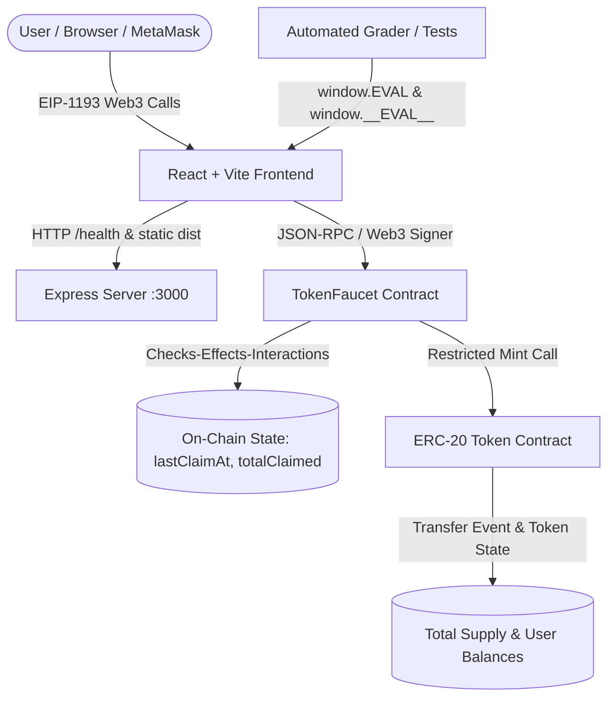
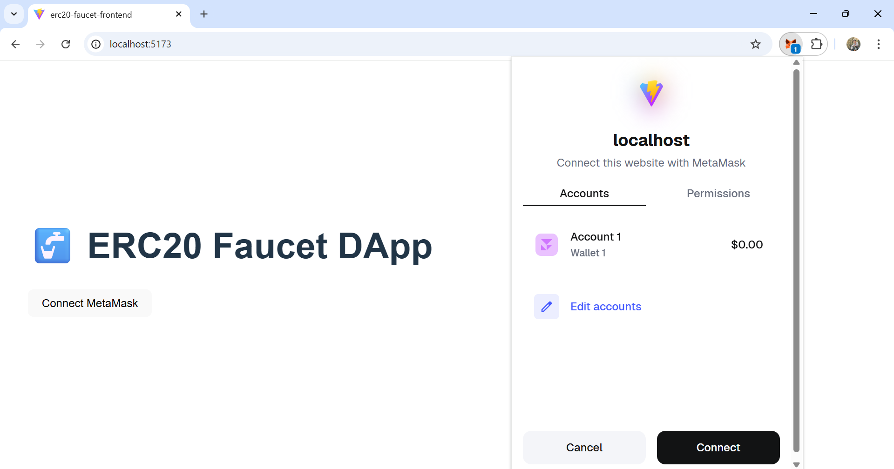
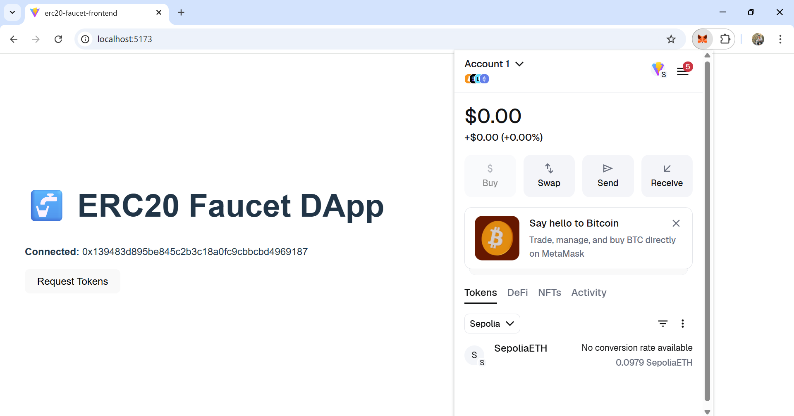
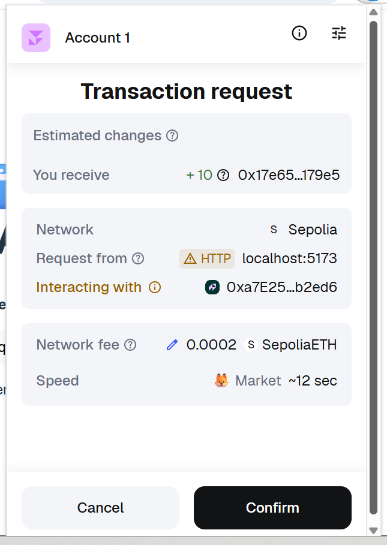
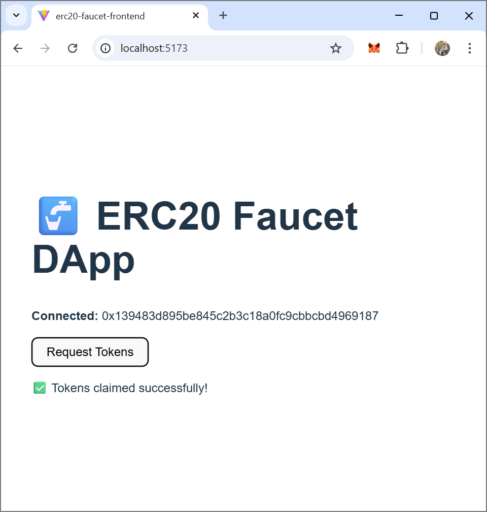
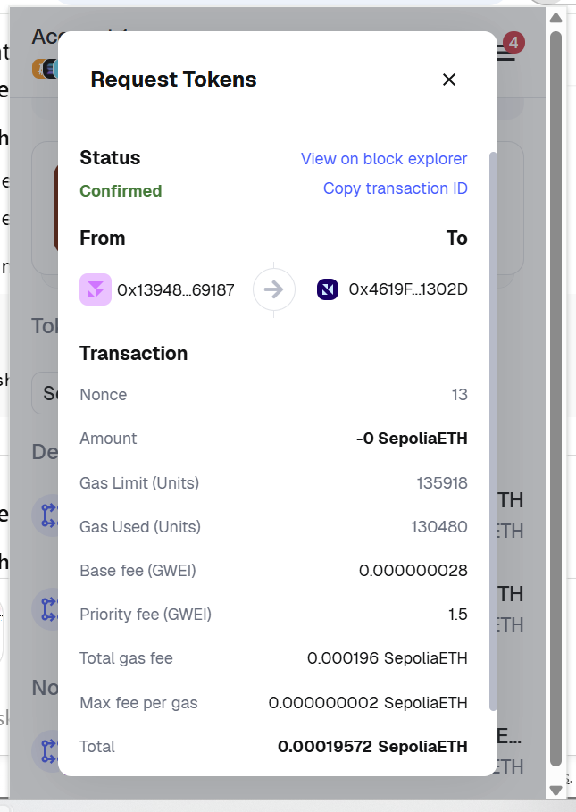
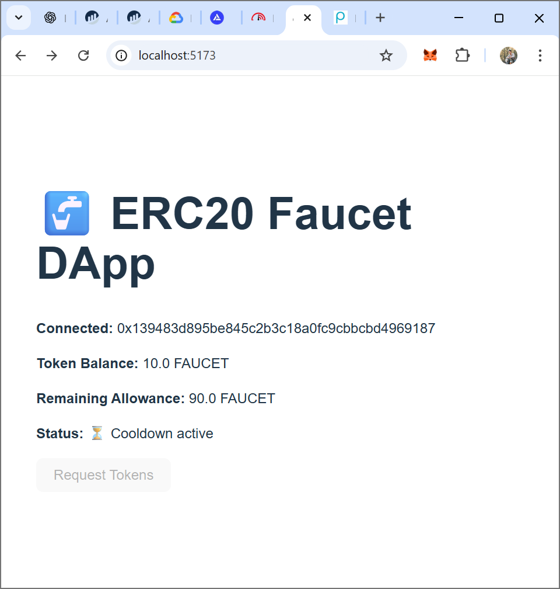
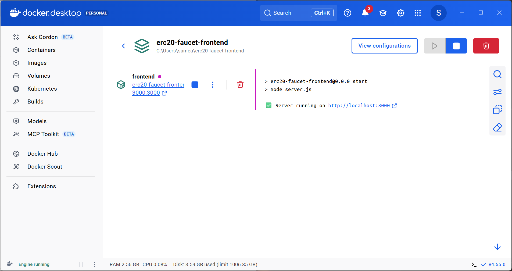
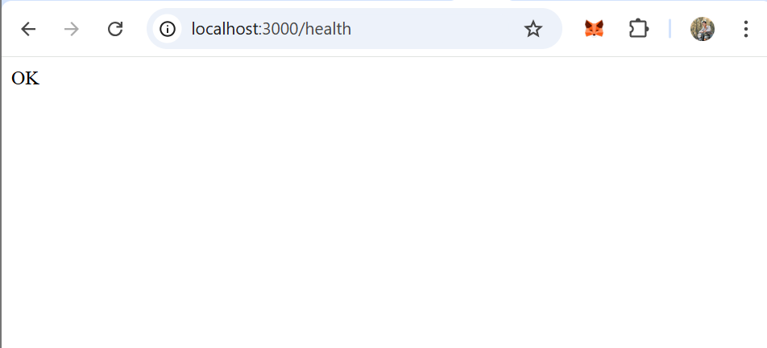

# ERC-20 Token Faucet DApp with On-Chain Rate Limits


A production-ready full-stack decentralized application (DApp) that distributes ERC-20 tokens with strictly enforced on-chain rate limits, 24-hour cooldown periods, lifetime claim quotas, and admin pause control. The project is fully containerized with Docker, includes a complete automated test suite, exposes deterministic testing interfaces (`window.__EVAL__` and `window.EVAL`), and connects to MetaMask via EIP-1193 standards.

---

## 📌 Table of Contents
1. [Project Overview](#project-overview)
2. [Architecture](#architecture)
3. [Deployed Contracts (Sepolia Testnet)](#deployed-contracts-sepolia-testnet)
4. [Design Decisions & Tokenomics](#design-decisions--tokenomics)
5. [Security Considerations](#security-considerations)
6. [Evaluation Interface (`window.__EVAL__` / `window.EVAL`)](#evaluation-interface-window__eval----windoweval)
7. [Screenshots & Visual Evidence](#screenshots--visual-evidence)
8. [Video Demonstration](#video-demonstration)
9. [Quick Start & Docker Deployment](#quick-start--docker-deployment)
10. [Local Development & Testing](#local-development--testing)
11. [Configuration](#configuration)
12. [Known Limitations](#known-limitations)

---

## Project Overview

The ERC-20 Token Faucet DApp demonstrates decentralized application engineering by implementing on-chain access controls and trustless rate-limiting mechanisms directly within Ethereum smart contracts without relying on centralized off-chain authorities.

### Key Capabilities
- **ERC-20 Token Compliance**: Standard OpenZeppelin implementation with `transfer`, `approve`, `allowance`, `balanceOf`, `totalSupply`, and custom minting access control.
- **On-Chain Cooldown**: Enforces a strict 24-hour waiting period (`COOLDOWN_TIME = 86400s`) between consecutive claims per address using persistent storage (`lastClaimAt`).
- **Lifetime Maximum Quota**: Caps total distributions per address at 100 FTK (`MAX_CLAIM_AMOUNT`), tracked through persistent storage (`totalClaimed`).
- **Emergency Circuit Breaker**: Admin-only pause and unpause mechanism that halts distributions during maintenance.
- **Reactive Frontend**: Built with React and ethers.js v6; displays live balances, remaining lifetime quotas, real-time countdown timers, transaction confirmation notifications, and blockchain event subscriptions.
- **Dockerized Architecture**: Complete application packaged via Docker Compose with automated `/health` endpoint readiness checks.

---

## Architecture

The system consists of two primary smart contracts, a modern React single-page frontend, an Express production web server, and a dual-exposed evaluation interface:



### Component Breakdown
1. **`contracts/Token.sol`**:
   - Fixed maximum supply of 1,000,000 FTK (`MAX_SUPPLY = 1,000,000 * 10^18`).
   - Exclusive minting permissions granted to the `TokenFaucet` contract.
   - Emits standard ERC-20 `Transfer` events on all mint and transfer operations.
2. **`contracts/TokenFaucet.sol`**:
   - Dispenses a fixed amount of 10 FTK per valid claim (`FAUCET_AMOUNT`).
   - Validates cooldown state, lifetime allocation limits, contract pause state, and maximum supply before executing state changes.
   - Updates `lastClaimAt` and `totalClaimed` prior to external calls (Checks-Effects-Interactions pattern).
   - Inherits OpenZeppelin `ReentrancyGuard` on all state-changing functions.
3. **`frontend/src/`**:
   - `eval.js`: Exposes both `window.__EVAL__` and `window.EVAL` with full programmatic hooks and automated fallback for headless execution.
   - `utils/contracts.js`: Centralized ethers.js v6 contract provider, signer, and event listener abstractions.
   - `utils/wallet.js`: Handles EIP-1193 wallet connection, account changes, chain switching, and disconnection.
   - `App.jsx`: Responsive user interface with real-time countdown timer, claim buttons, balance displays, and descriptive error banners.
4. **`frontend/server.js`**:
   - Production Express container server listening on `0.0.0.0:3000`.
   - Exposes `/health` returning HTTP 200 `OK`.
   - Injects dynamic runtime environment configuration into `index.html`.

---

## Deployed Contracts (Sepolia Testnet)

Both contracts are deployed and verified on the Ethereum Sepolia testnet:

| Contract | Address | Etherscan Verification Link |
|---|---|---|
| **Token (`FTK`)** | `0x94c3761917fbfD840C8D64C61260C6f3b034f1b2` | [View on Etherscan](https://sepolia.etherscan.io/address/0x94c3761917fbfD840C8D64C61260C6f3b034f1b2#code) |
| **TokenFaucet** | `0x4619F64f0b51867A1f9C3e00317778790171302D` | [View on Etherscan](https://sepolia.etherscan.io/address/0x4619F64f0b51867A1f9C3e00317778790171302D#code) |

---

## Design Decisions & Tokenomics

### 1. Faucet Amount per Request (10 FTK)
- **Value**: `10 * 10^18` base units (10 tokens with 18 decimals).
- **Rationale**: 10 tokens provides sufficient quantity for users to test smart contract interactions (transfers, approvals, swaps) without depleting the pool rapidly. It ensures an intuitive balance display on testnet environments.

### 2. Cooldown Period (24 Hours)
- **Value**: `24 hours` (86,400 seconds).
- **Rationale**: 24 hours prevents script-based transaction flooding and rate-limits distribution to one claim per day per Ethereum address. It provides a realistic test cycle and aligns with industry testnet faucets.

### 3. Lifetime Claim Limit (100 FTK)
- **Value**: `100 * 10^18` base units (100 tokens max lifetime).
- **Rationale**: Enables each unique user address to claim up to 10 times over their lifetime. Even with prolonged waiting periods, a single address cannot indefinitely drain the supply.

### 4. Fixed Maximum Supply (1,000,000 FTK)
- **Value**: `1,000,000 * 10^18` base units.
- **Rationale**: Guarantees a hard supply ceiling. Even if up to 10,000 separate user addresses exhaust their entire 100 FTK lifetime allowance, the total supply will never inflate beyond the predefined constant.

---

## Security Considerations

1. **Reentrancy Protection**:
   - All state modifications (`lastClaimAt` and `totalClaimed`) precede the external `token.mint()` invocation (Checks-Effects-Interactions pattern).
   - The `requestTokens()` function uses OpenZeppelin's audited `ReentrancyGuard` (`nonReentrant` modifier).
2. **Strict Access Control**:
   - `Token.sol` restricts minting authorization exclusively to the authorized faucet address. Unauthorized addresses invoking `mint()` are rejected with `"Only faucet can mint"`.
   - `TokenFaucet.sol` restricts `setPaused()` exclusively to the contract `admin` (deployer). Non-admin attempts revert with `"Only admin"`.
3. **Integer Arithmetic Safety**:
   - Developed using Solidity `^0.8.20`, which includes native compiler-level overflow and underflow checks.
4. **Descriptive Revert Reasons**:
   - Reverts include human-readable error reasons:
     * `"Cooldown period not elapsed"`
     * `"Lifetime claim limit reached"`
     * `"Faucet is paused"`
     * `"Insufficient token supply"`
     * `"Only admin"`
     * `"Only faucet can mint"`

---

## Evaluation Interface (`window.__EVAL__` / `window.EVAL`)

The frontend globally exposes both `window.__EVAL__` and `window.EVAL` to support automated testing:

```javascript
// Check eligibility
const eligible = await window.__EVAL__.canClaim("0xYourAddress"); // returns boolean

// Check current token balance in base units
const balance = await window.__EVAL__.getBalance("0xYourAddress"); // returns string

// Check remaining lifetime allowance in base units
const remaining = await window.__EVAL__.getRemainingAllowance("0xYourAddress"); // returns string

// Request tokens from faucet
const txHash = await window.__EVAL__.requestTokens(); // returns transaction hash string

// Retrieve deployed contract addresses
const addrs = await window.__EVAL__.getContractAddresses();
// returns { token: "0x...", faucet: "0x..." }

// Connect wallet
const connectedAddress = await window.__EVAL__.connectWallet(); // returns string
```

All numeric values are returned as decimal strings to prevent BigInt precision loss in JavaScript runtimes.

---

## Screenshots & Visual Evidence

All visual demonstration assets are located in the [`screenshots/`](./screenshots/) directory:

| Screenshot | Description |
|---|---|
|  | **01: Frontend Loaded** — Initial DApp interface prior to wallet connection. |
|  | **02: Wallet Connected** — MetaMask connected, displaying address, balance, and allowance. |
|  | **03: Request Tokens** — MetaMask confirmation prompt for `requestTokens()`. |
|  | **04: Claim Success** — Transaction confirmed, balance updated, success notification visible. |
|  | **05: On-Chain Confirmation** — Transaction confirmed on blockchain explorer. |
|  | **06: Cooldown Active** — Cooldown banner active with countdown timer; claim button disabled. |
|  | **07: Docker Container** — Application container running with port 3000 mapping. |
|  | **08: Health Check** — `/health` endpoint returning HTTP 200 `OK`. |

---

## Video Demonstration

A complete walkthrough video demonstration showing wallet connection, balance queries, successful token claim, cooldown enforcement, and balance synchronization is available here:

🔗 **[Watch Video Demonstration](https://drive.google.com/file/d/1erlrP8EWoz2MM041xQAdRMsArWyou6pO/view?usp=sharing)**

*(Also mirrored in [`video_demonstration.txt`](./video_demonstration.txt))*

---

## Quick Start & Docker Deployment

### 1. Clone the Repository
```bash
git clone https://github.com/sucha6174/erc20-faucet-dapp.git
cd erc20-faucet-dapp
```

### 2. Configure Environment
```bash
cp .env.example .env
```

### 3. Run with Docker Compose
```bash
docker compose up --build
```

The frontend will be accessible at **http://localhost:3000** within 60 seconds.  
The health check endpoint is available at **http://localhost:3000/health**.

---

## Local Development & Testing

### 1. Install Dependencies
```bash
npm install
npm --prefix frontend install
```

### 2. Run Smart Contract Tests
Execute the comprehensive Hardhat test suite:
```bash
npx hardhat test
```

Expected output:
```text
  Evaluation Interface (__EVAL__ and EVAL) End-to-End Test
    ✔ should verify all eval interface contract methods

  Token and TokenFaucet Test Suite
    Auto-authorization without setFaucet
      ✔ should allow requestTokens even if setFaucet was never called
    1. Token Deployment & ERC-20 State
      ✔ should initialize token metadata correctly
      ✔ should support ERC-20 approve and allowance functions
      ✔ should support transfer function and emit Transfer event
      ✔ should restrict minting to faucet only
    2. Faucet Deployment & Initial Configuration
      ✔ should set correct constants and state
      ✔ should confirm canClaim returns true for new addresses
    3. Token Claiming & Cooldown Enforcement
      ✔ should allow an eligible user to request tokens successfully
      ✔ should emit TokensClaimed and Transfer events on claim
      ✔ should revert with clear message on immediate re-claim (cooldown active)
      ✔ should allow claiming again after cooldown period elapses
      ✔ should allow multiple users to claim independently without affecting each other
    4. Lifetime Limit Enforcement
      ✔ should enforce lifetime claim limit and revert when limit reached
      ✔ should return correct remainingAllowance throughout claim lifecycle
    5. Pause Mechanism & Admin Access Control
      ✔ should allow admin to pause and unpause, emitting FaucetPaused event
      ✔ should revert when non-admin tries to pause or unpause

  17 passing (1s)
```

### 3. Deploy Contracts Locally
```bash
npx hardhat node
npx hardhat run scripts/deploy.js --network localhost
```

### 4. Run Frontend in Development Mode
```bash
cd frontend
npm run dev
```
Open **http://localhost:5173** in your browser.

---

## Configuration

| Environment Variable | Description | Default / Example |
|---|---|---|
| `VITE_RPC_URL` | Ethereum RPC endpoint for frontend provider | `https://eth-sepolia.g.alchemy.com/v2/...` or `http://localhost:8545` |
| `VITE_TOKEN_ADDRESS` | Deployed ERC-20 Token contract address | `0x94c3761917fbfD840C8D64C61260C6f3b034f1b2` |
| `VITE_FAUCET_ADDRESS` | Deployed TokenFaucet contract address | `0x4619F64f0b51867A1f9C3e00317778790171302D` |
| `PRIVATE_KEY` | Deployer private key (for deployment scripts only) | *(Do not commit)* |
| `SEPOLIA_RPC_URL` | Sepolia RPC endpoint for Hardhat deployments | `https://rpc.sepolia.org` |
| `ETHERSCAN_API_KEY` | Etherscan API key for contract verification | `YOUR_ETHERSCAN_API_KEY` |

---

## Known Limitations

- **Single Token Distribution**: Faucet distributes one ERC-20 token asset (`FTK`). Multi-token distribution pools would require an extended registry pattern.
- **Fixed Cooldown**: Cooldown is set to 24 hours. Dynamic cooldown tiers based on reputation or staking are left for future protocol iterations.
- **Testnet Reliance**: Deployments target Sepolia testnet. Testnet block times and occasional RPC provider throttling may affect transaction receipt confirmation latency.

---

## Author
- GitHub: [@sucha6174](https://github.com/sucha6174)
- Repository: [https://github.com/sucha6174/erc20-faucet-dapp](https://github.com/sucha6174/erc20-faucet-dapp)
